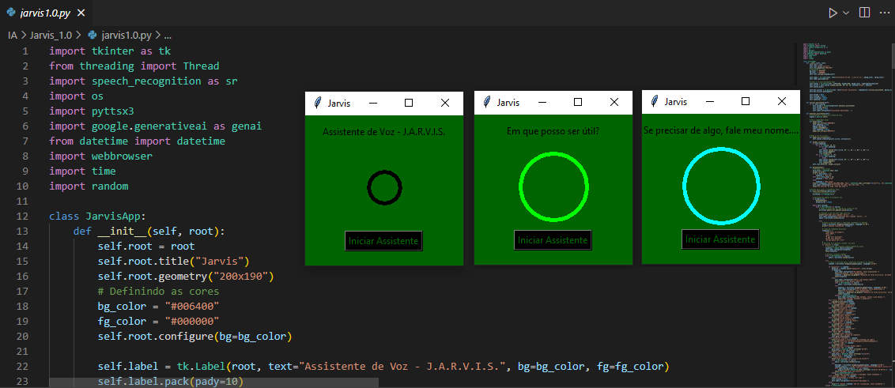

# J.A.R.V.I.S. 1.1 — "Just A Rather Very Intelligent System"

Assistente de voz para Windows (tkinter + SpeechRecognition + pyttsx3 + Gemini), baseado no
projeto original `Jarvis_1.0` de Carlos-CGS, atualizado e modularizado.



## Instalação (PowerShell)

```powershell
cd "$env:USERPROFILE\Downloads\Jarvis"
powershell -ExecutionPolicy Bypass -File install.ps1
```

O script instala o Python 3.12 (se preciso), cria o `.venv`, instala as dependências, roda os testes,
cria o `.env` e um atalho **Jarvis** na Área de Trabalho.

Depois, edite o arquivo `.env` e preencha:

- `GEMINI_API_KEY`: chave gratuita em <https://aistudio.google.com/apikey>
- `JARVIS_USER_NAME`: seu nome (usado na saudação)

## Execução

- Clique duas vezes no atalho **Jarvis** da Área de Trabalho, ou em `iniciar_jarvis.bat`, ou
- `.venv\Scripts\python -m jarvis` (mostra os logs no terminal).

Clique em **Iniciar Assistente**, diga **"Jarvis"** e, depois da resposta, diga o comando.
Também dá para falar tudo de uma vez: *"Jarvis, que horas são"*.

## Comandos suportados

| Fale | Ação |
|---|---|
| Pesquisar *assunto* | Responde com o Gemini, no estilo do Jarvis |
| Tocar música | Pergunta a música e abre a busca no YouTube |
| Abrir navegador | Abre o navegador padrão |
| Abrir calculadora / Paint / bloco de notas | Abre o app do Windows |
| Abrir Excel / Word | Abre o Microsoft Office (se instalado) |
| Abrir CMD | Abre o prompt de comando |
| Consertar internet | Abre Configurações › Solução de problemas (o MSDT foi aposentado no Windows 11 24H2+) |
| Abrir VS Code | Abre o Visual Studio Code |
| Que horas são / Que dia é hoje | Informa a hora/data |
| Transcrever | Dita uma mensagem e salva em `mensagens_salvas.txt` na Área de Trabalho |
| Desligar sistema | Desliga o assistente |

Os comandos não diferenciam maiúsculas/minúsculas nem acentos.

## Arquitetura

```
jarvis/
├── app.py              composição (cria dependências, liga UI e assistente)
├── assistant.py        loop: saudação, palavra de ativação, despacho
├── config.py           leitura/validação do .env
├── contracts.py        protocolos (Speaker, Listener, AnswerProvider...) e exceções
├── text_utils.py       normalização de texto
├── commands/           registro + comandos (sistema, info, mídia)
├── services/           Gemini, arquivo de mensagens, abertura de programas
├── speech/             microfone (Google Speech) e voz (SAPI5)
└── ui/                 janela tkinter e tema
```

## Testes

```powershell
.venv\Scripts\python -m pytest
```

## Requisitos

- Windows 10/11, microfone e alto-falante
- Internet (reconhecimento de fala do Google e API do Gemini)
- Para voz em português: Configurações › Hora e idioma › Fala › adicionar voz *Português (Brasil)*

> Por que não Docker? O assistente abre programas do Windows (calc, Paint, Office, CMD, Configurações)
> e usa o microfone, o áudio e a interface gráfica do sistema. Um container Linux do Docker Desktop
> não tem acesso a nada disso, por isso a instalação é nativa.
